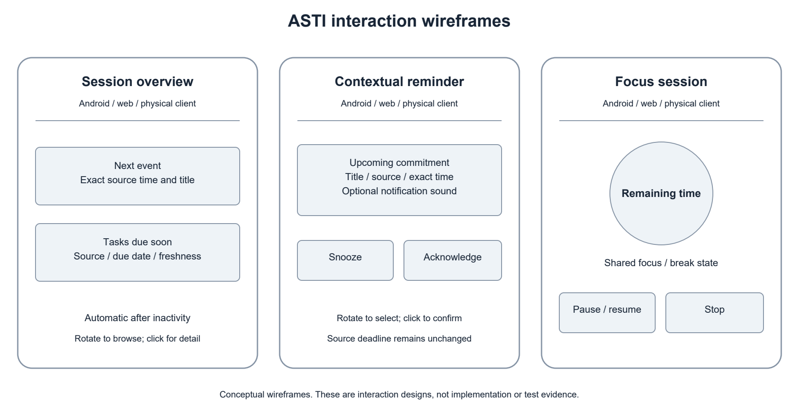
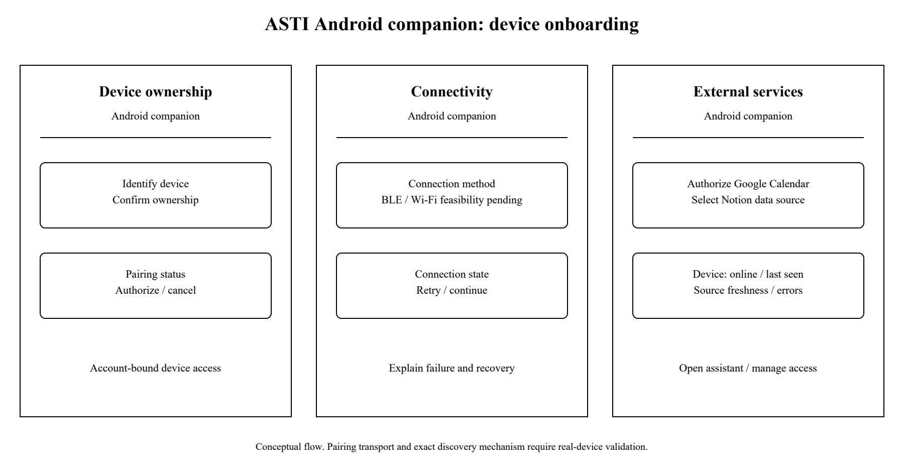

# ASTI First Probationary Period Report

Development of an Intelligent System for a Physical Desktop Assistant with a Mobile Application and External Service Integration

Author: Yan Kudashov (Кудашов Ян Сергеевич), SE-2413

Supervisor: Сарсенова Жибек Нуржановна

Astana IT University | Software Engineering | 24 October 2026

Repository: https://github.com/Kreichik/asti

Task management: https://asti-diploma.youtrack.cloud/

## 1 Project proposal

### 1.1 Problem and intended users

ASTI is an intelligent software system for a physical desktop assistant. Its central engineering problem is how a small display-and-rotary device can provide dependable assistance while its software services, mobile companion and external integrations remain coordinated. The system must associate a device with its owner, configure it through Android, deliver relevant information, interpret device actions and recover consistent state after connection loss. A web interface provides another usable access channel to the same assistant.

Tasks, events and focus sessions are the initial application domain used to exercise this architecture. Google Calendar and Notion supply authorized data; they are not the system being developed and are not the principal competing assistant platforms. The working user hypothesis is that a physical, glanceable interface with lightweight controls can make selected information convenient to access at a desk. Whether it adds value beyond existing screens requires evaluation.

The intended users are people who study or work at a desk, including students, freelancers and office employees. Initial exploratory discussions cover two students and one office employee. The first implementation concentrates on the overlap between task tracking, scheduled events and focus sessions rather than occupation-specific workflows.

### 1.2 Aim and objectives

The aim is to design, implement and evaluate an intelligent software system that operates a physical desktop assistant through a secure device protocol, a mobile companion application and external-service adapters, with consistent assistant state and a supporting web interface.

Objectives are to: analyze software platforms for physical assistants and relevant interaction research; specify verifiable requirements; define the backend, mobile and device-software boundaries; implement device onboarding, authorization, state delivery and action handling; provide Android configuration and everyday assistant controls with a supporting web client; connect Google Calendar and a selected Notion source through independent adapters; add source-grounded briefings with a replaceable model; and evaluate real-device behavior, recovery, integration correctness and usability.

### 1.3 Scope and expected outcomes

The expected deliverables are a documented backend, Android application, web application, Google Calendar and Notion adapters, a physical-client communication interface, deployment instructions, tests and evaluation results. Core scenarios are an automatically presented session-start overview, contextual reminders with acknowledgment/snooze, and a focus timer with optional character feedback. Android and web are independent usable interfaces to the same assistant. They are not simulations of a physical device.

The physical client is expected to have a small round display and a rotary ring with click and observable rotation steps. This project specifies and implements its software interaction boundary. Electronic circuit design, enclosure manufacture, camera input, mandatory voice input and training a foundation model are outside the core scope. Optional sound and character interaction must not become prerequisites for calendar and reminder functions. Further connectors, including Trello, Microsoft Teams and Moodle, are future candidates rather than committed first-version features.

### 1.4 Engineering contribution

The engineering challenge lies in defining a hardware-independent software boundary for the desktop assistant: device identity and ownership, capability-aware presentation, authenticated action handling, reconnect recovery and shared state with the mobile companion. External-source normalization, date semantics and source-grounded generation support that system rather than replacing its device-facing purpose. A language-model API is one replaceable dependency. The contribution is the integrated software architecture and its verified behavior, not a claim of a newly trained model or novel hardware.

## 2 Evidence of the relevance

### 2.1 Available exploratory evidence

I conducted three exploratory discussions in person: two with students and one with an office employee. The notes summarize the tools and contexts described during those conversations. They do not include dated transcripts or separately attributed answers from the two students.

| Participants | Reported workflow facts | Implication for exploration |
| --- | --- | --- |
| Two students, summarized together | Use of Notion, Google Calendar and Notion Calendar for organization; occasional Microsoft Teams academic calls/events; much current academic interaction takes place in person | Calendar and task data are relevant sources; a calendar view alone may already satisfy some needs |
| One office employee | Trello for work task tracking and Microsoft Teams for calls | Service diversity matters; Trello/Teams are candidates for future connectors |

The discussions establish use of relevant tools in a small convenience sample. They provide an initial basis for selecting connectors, but do not yet establish the frequency of missed deadlines, the effort of checking separate sources or demand for the proposed assistant.

### 2.2 Findings versus assumptions

Recorded findings: the three participants use the listed task, calendar and meeting tools. Design hypotheses: a short session-start overview is useful; contextual reminders reduce repeated checking; a focus timer and optional character are acceptable; the physical client adds value for some users. These hypotheses require follow-up with concrete interface materials.

The next interview round should ask participants to reconstruct a recent workday, show how they find upcoming obligations, describe any actual failures or friction, and compare the proposed overview/reminder/focus flows with their current practice. Notes should include interview date, anonymized participant ID and consent to use the findings. An explanation of a desired feature must not be recorded as a demonstrated user need.

## 3 Literature review

### 3.1 Selection and analytical approach

This targeted review covers tangible and ambient interaction, notifications, digital self-control, grounded language generation and gamification. Five of the ten scientific publications below are from 2022-2024. Tangible and ambient-interface studies [25,26] are retained as foundational work directly relevant to the physical assistant; they do not establish current product capabilities. Older sources are retained for their specific foundational role, not as evidence of current product capabilities. Official technical documentation is used separately for integration contracts and technology decisions. The review is a focused design review rather than an exhaustive systematic review.

### 3.2 Structured analysis of scientific publications

| Source | Approach and relevant finding | Limitation for ASTI | Design consequence |
| --- | --- | --- | --- |
| [1] Mark et al., 2008 | Experimental study of interrupted work; participants compensated by working faster while reporting greater strain | Controlled tasks do not establish ASTI's effect in daily work | Evaluate interruption burden; avoid assuming that more reminders mean better outcomes |
| [2] Pielot et al., 2014 | One-week field study with 15 users combining notification logs and diaries; notifications had both social benefits and costs | Small sample and an older mobile ecosystem | Provide timing controls, snooze and acknowledgment; measure usefulness by scenario |
| [3] Lyngs et al., 2022 | Analysis of digital self-control tool reviews and adoption indicators; users sought an appropriate, adaptable level of support | Self-selected reviews cannot establish causal productivity gains | Let users configure interruption/focus policies and disable optional character features |
| [4] Monge Roffarello and De Russis, 2023 | Systematic review and meta-analysis of digital self-control tools; identifies design and evaluation gaps | Technology-use reduction is not equivalent to fulfilling work obligations | Measure task comprehension and system behavior, not screen-time reduction alone |
| [5] Ji et al., 2023 | Survey of hallucination in natural language generation, including generation inconsistent with supplied sources | Broad survey, not an evaluated ASTI briefing model | Retain source IDs, validate critical dates, measure unsupported statements and provide fallback |
| [6] Liu et al., 2024 | Controlled long-context retrieval/QA experiments; performance depends on the position of relevant information | Studied models and tasks differ from short personal briefings | Select a bounded relevant record set; do not send an entire account history as context |
| [7] Li et al., 2024 | Meta-analysis and review of educational gamification; motivational effects are context dependent | Educational interventions do not establish benefit from a desktop character | Keep character support optional; separate usability evaluation from motivational claims |
| [8] Brooke, 1996 | Introduces a low-cost system-level perceived-usability questionnaire | Subjective usability does not prove reliability or objective productivity | Use a standardized usability measure alongside task completion and operational metrics |
| [25] Ishii and Ullmer, 1997 | Describes tangible interaction and ambient presentation through physical interfaces | Conceptual and prototype work, not evidence that ASTI improves productivity | Separate device input/output mapping from domain services; evaluate actual rotary interaction |
| [26] Pousman and Stasko, 2006 | Taxonomy of ambient systems using information capacity, notification level, representational fidelity and aesthetic emphasis | Design taxonomy, not an implementation protocol or efficacy benchmark | Fit overview detail to the small display, control notification salience and keep character styling optional |

### 3.3 Critical synthesis

Tangible interaction [25] and ambient-system design [26] provide the physical-interface foundation. They motivate explicit software mappings between information, display states and physical actions, with careful control of attention demands. A persistent object or character is not evidence of benefit by itself. The backend should expose assistant state independently of one screen or input mechanism, and evaluation must include the actual device rather than only a phone UI.

The interruption literature [1,2] motivates careful notification control rather than a promise that a persistent display is inherently beneficial. Research on self-control tools [3,4] reinforces the importance of user choice and the distinction between reducing device use and helping users perform intended work. ASTI therefore proposes configurable reminders and a focus mode, with an explicit evaluation of whether users understand the presented obligations.

Generation research [5,6] motivates a narrow role for the model. Calendar times, reminder schedules and source identities remain deterministic data. The model summarizes a selected set of records and must not invent dates, task completion or user preferences. The evaluation compares generated briefings with the imported records and a deterministic ordered overview. There is no need for a vector database or model training unless later evidence justifies it.

Gamification research [7] does not establish that a character will improve work motivation. Character animation is an optional interaction layer. Usability assessment [8] will accompany objective task and failure measurements, with results reported only after evaluation actually occurs.

## 4 Existing system comparison

### 4.1 Comparable systems and evidence

Three relevant software systems are compared: Home Assistant with Assist [22], OpenVoiceOS [23] and Stack-chan [24]. They represent a device-and-service platform, a modular assistant runtime and an embedded desktop companion respectively. They are architectural and interaction analogues, not three identical products. All address software associated with physical assistant devices; their different scopes make the tradeoffs explicit.

The comparison uses eight consistent criteria. It is based on official project documentation inspected on 24 October 2026, not installation tests. A feature not established by these sources is marked as unverified rather than absent. ASTI's proposed properties are design targets, not demonstrated advantages.

| Criterion | Home Assistant / Assist [22] | OpenVoiceOS [23] | Stack-chan [24] |
| --- | --- | --- | --- |
| Main software scope | Device/service platform with an assistant | Modular voice-assistant runtime | Firmware and applications for a desktop companion |
| Physical execution boundary | Server plus dedicated or custom satellites | Linux runtime with a hardware abstraction layer | Embedded M5Stack firmware |
| Physical interaction | Voice-assistant hardware; other device controls depend on configuration | Voice pipeline; PHAL exposes hardware controls | Screen face and embodied device interaction |
| Mobile / web companion evidence | Companion app and browser dashboard | GUI service documented; ASTI-like mobile onboarding unverified | Browser setup and preference tools; Android companion unverified |
| External-service extension | Integration catalogue | Skills and plugins | User applications (MODs); connector behavior application-specific |
| Hardware abstraction | Integrations and satellite interfaces | PHAL separates hardware-specific functions | Firmware targets and replaceable renderer/driver interfaces |
| Intelligent behavior boundary | Local voice foundation; optional model integration | Intent/skill pipeline with replaceable speech components | Behavior defined through firmware and MODs; no universal intelligence guarantee |
| Reuse / adaptation for ASTI | Reuse platform services; custom rotary display and domain flows need validation | Reuse assistant modules; voice-first runtime adds scope without required voice input | Reuse embedded interaction patterns; account/backend companion functions need separate validation |

### 4.2 Implications and limitations

The comparison shows that physical-assistant software, extensibility and hardware abstraction already exist. ASTI cannot claim to invent those ideas. The project proposes a bounded software system for a screen-and-rotary desktop assistant: Android onboarding, device authorization, shared state, reliable device actions and external-service adapters, exercised through overview, reminder and focus scenarios. The contribution must be demonstrated through implementation and measurements, not an unsupported claim that these platforms cannot be extended.

Home Assistant is the main reuse alternative for connecting device interfaces and services. OpenVoiceOS informs separation of assistant services from hardware-specific controls. Stack-chan informs embedded companion presentation and software customization. None was installed for this report; suitability, effort and end-to-end behavior require feasibility checks. Section 5.5 explicitly compares reuse with a standalone backend before implementation commits to one route.

### 4.3 External sources versus system analogues

Google Calendar and Notion remain initial external data sources because they match the exploratory student workflows and have documented access mechanisms [9-11]. Notion Calendar already brings calendar accounts and dated Notion entries together [12], so aggregation alone is not a novelty claim. Trello's dated-card workflow [13,14] is relevant to the office participant and possible later connectors. These services describe input data and existing user practice; they are not the main comparison set for a physical-assistant software system.

## 5 Technology comparison

### 5.1 Backend framework

| Alternative | Fit with requirements | Main tradeoff | Initial decision |
| --- | --- | --- | --- |
| FastAPI [15] | Python API, schema validation and documented contracts for several clients | Authentication, job execution and operational policies still require deliberate implementation | Preferred for an API-centered modular backend |
| Django [16] | Python framework with built-in authentication, administration and ORM | More framework structure; a separate API layer and background execution choices remain necessary | Viable if administration-heavy workflows become central |

FastAPI is the provisional preference because client contracts and integration adapters dominate this project's initial scope, and Python matches the author's experience. This is a design judgment, not a measured performance comparison. Start with one modular application and separately runnable workers rather than independent microservices.

### 5.2 Data storage

| Alternative | Fit with requirements | Main tradeoff | Initial decision |
| --- | --- | --- | --- |
| PostgreSQL [17] | Shared relational state for users, connector ownership, source items, reminders and device sessions | Requires service operation, backups and migrations | Preferred central database |
| SQLite [18] | Low-administration embedded/local storage and small deployments | A central multi-client workload needs deliberate concurrency and deployment assessment | Suitable for local tooling or limited cache use, not the initial shared-store choice |

Relational uniqueness constraints are important for idempotent imports and reminder occurrences. The storage model should key source items by user/connection, provider and external identity. Date-only deadlines remain distinct from exact timestamps. No vector store is justified for the initial bounded overview.

### 5.3 Device communication

| Alternative | Fit with requirements | Main tradeoff | Initial decision |
| --- | --- | --- | --- |
| HTTPS polling | Simple request/response and recoverable snapshots | Update delay and repeated requests depend on polling interval | Baseline option for early hardware validation |
| Secure WebSocket [19] | Persistent bidirectional updates for state and rotary actions | Requires reconnect, heartbeat, authorization and replay rules | Preferred initial live channel, subject to microcontroller testing |
| MQTT over TLS [20] | Publish/subscribe designed for constrained clients | Adds a broker, topic authorization and delivery-state semantics | Alternative if device constraints justify broker operation |

The device protocol carries state revisions, action IDs, timestamps and acknowledgments. A transport does not itself guarantee exactly-once user actions: the application must deduplicate repeated action IDs. Reconnecting clients first receive a current snapshot rather than blindly replaying expired reminders.

### 5.4 Client framework and model deployment

Flutter supports Android and web targets [21] and matches the author's experience. Shared presentation/domain code is desirable, while pairing and platform-specific storage need separate implementations and verification. Native Android plus a separate web stack is an alternative with more independently maintained client code; a web-only implementation would not satisfy the planned Android deliverable.

For the model dependency, compare a hosted pretrained-model API, a self-hosted model and a deterministic-only briefing baseline. A hosted provider behind a replaceable adapter is the initial preference. Provider choice remains open until quality, latency, data handling and cost are measured. Available VPS access is not evidence of sufficient resources for local inference. The deterministic overview remains operational if model generation fails.

### 5.5 System foundation: build versus extend

| Alternative | Fit and reuse | Main tradeoff | Provisional decision |
| --- | --- | --- | --- |
| Standalone ASTI backend | Explicit device contracts, account ownership and Android/web domain flows | Must implement authorization, scheduling and adapter lifecycle | Initial preference, subject to a bounded feasibility comparison |
| Extend Home Assistant [22] | Existing device/service platform and companion access | Need to map the rotary display, user/account model and task semantics onto platform conventions | Strong reuse candidate; verify with one real-device state/action path |
| Extend OpenVoiceOS [23] | Existing assistant modules and hardware abstraction | Voice-oriented services may be unnecessary for a display-and-rotary baseline | Reconsider if voice becomes central; do not add a microphone to justify the platform |

FastAPI is a backend framework choice within the standalone route, not evidence that this route is automatically better than extending an assistant platform. Before full implementation, compare the smallest end-to-end path for device authorization, one displayed record, one rotary action and reconnect. Record required customization and operational dependencies. Stack-chan is an embedded implementation reference, not a drop-in substitute for the whole backend and mobile companion.

## 6 Requirements specification

### 6.1 Functional requirements

Priorities use Must for baseline acceptance and Should for a valuable extension. The criteria below are planned checks, not completed test results.

| ID | Priority | Requirement and acceptance criterion |
| --- | --- | --- |
| FR-01 | Must | Authenticate users and isolate their data: one user cannot read another user's items, connection secrets or device controls |
| FR-02 | Must | Import Google Calendar events preserving external identity, start/end, time zone and source reference; report revoked authorization |
| FR-03 | Must | Import selected Notion task data using documented property mapping; absent due dates remain absent |
| FR-04 | Must | Preserve provider, external ID, connection ownership, source URL where available and last successful synchronization |
| FR-05 | Must | Present an overview automatically on first interaction after a configurable inactivity interval, without restarting it on every menu action |
| FR-06 | Must | Schedule contextual reminders; snooze affects the reminder, not the external deadline; acknowledgment is synchronized |
| FR-07 | Must | Start, pause, resume and stop focus/break intervals; recover timer state from authoritative timestamps after reconnection |
| FR-08 | Must | Support overview, integration/settings management and focus controls in Android and web without requiring a physical device |
| FR-09 | Must | Pair an identified physical client with an account and revoke its subsequent access |
| FR-10 | Must | Map rotary steps to selection and click to confirmation, including reminder snooze and focus start |
| FR-11 | Must | Generate source-grounded briefing text with a bounded timeout and deterministic fallback; failed generation does not stop reminder delivery |
| FR-12 | Should | Provide independently optional sound and character feedback without removing core functions when disabled |
| FR-13 | Must | Display synchronization freshness and actionable connection errors; stale records are not described as live |
| FR-14 | Should | Permit manual synchronization without duplicate source items |
| FR-15 | Must | Negotiate a versioned device contract with display/input capabilities; unsupported protocol versions receive an explicit compatibility error |
| FR-16 | Must | Validate device actions by owner, action ID and state revision; retries have one accepted effect and reconnect restores current state |

### 6.2 Nonfunctional requirements

| ID | Priority | Requirement and proposed acceptance condition |
| --- | --- | --- |
| NFR-01 | Must | No connector tokens in Git, logs or client responses; encrypt stored tokens with separately managed key material |
| NFR-02 | Must | Repeated imports and repeated action IDs do not create duplicate records or effects |
| NFR-03 | Must | Explicit time semantics cover UTC/local conversion, all-day events, date-only tasks, recurrence exceptions and midnight boundaries |
| NFR-04 | Must | Network recovery restores current state and follows a documented policy for missed/expired reminders |
| NFR-05 | Should | Proposed p95 ordinary backend response below 500 ms under a documented test workload, excluding external/provider waits |
| NFR-06 | Should | Proposed healthy-connection server reminder dispatch within 5 seconds of its schedule; import freshness is measured separately |
| NFR-07 | Must | Model calls have a configured timeout, fallback and non-sensitive latency/usage diagnostics |
| NFR-08 | Must | Connector additions do not require changing focus-timer or client domain logic |
| NFR-09 | Must | Trace imports, reminders and actions using correlation identifiers; verify key failure paths |

The numeric performance targets are provisional engineering acceptance targets, not established user requirements or observed results. Final thresholds will be reviewed against VPS specifications and measured load. External write-back, default reminder timing, inactivity threshold and Wi-Fi/Bluetooth provisioning remain open decisions. The current baseline reads external sources; acknowledging an ASTI reminder does not complete a Notion task.

## 7 Architecture and Diagrams

### 7.1 Architectural organization

The software boundary has three first-class parts: the physical-client software and protocol, the Android companion, and the assistant backend. The supporting web client uses the same domain state. The proposed architecture is a modular backend with integration adapters, normalized storage, briefing generation, reminder scheduling, focus state and authenticated client gateways. Periodic workers import remote changes with pagination, retry/backoff and idempotent upserts. Provider credentials stay on the server. Clients receive application records and state, not raw service credentials.

The system context identifies the user, ASTI and the three external dependencies: Google Calendar, Notion and the replaceable model provider. The use-case view covers connection setup, automatic overview, reminders, snooze/acknowledgment, focus sessions, device pairing and settings. The draft component view separates client interfaces, domain services, workers, persistence and adapters.

Editable sources and exports: https://github.com/Kreichik/asti/tree/main/docs/diagrams

### 7.2 Data and consistency

Core entities are User, ServiceConnection, SourceItem, ReminderOccurrence, Device, DeviceSession, DeviceAction, FocusSession and Briefing. Device records ownership, supported protocol version, display/input capabilities and revocation status. DeviceSession records connection freshness and delivered state revision; DeviceAction records the accepted action ID and outcome so retry handling is inspectable. SourceItem distinguishes task and event records and retains provenance and freshness. ReminderOccurrence has a stable deduplication key, scheduled time, status and acknowledgment/snooze history. FocusSession records state and authoritative server times; clients derive remaining duration rather than each maintaining an unrelated countdown.

Client actions include an action ID and expected state revision. The backend validates ownership and applies each accepted action once. Device reconnect uses a snapshot plus later revisions. The display retains an explicit offline indicator when disconnected; it must not imply that locally cached records are newly synchronized.

### 7.3 Model boundary and failure behavior

The briefing service selects relevant normalized records, attaches source IDs and requests a bounded structured response. Critical event times and deadlines are rendered from the stored records. Generated text is treated as presentation content and never as authority to reschedule events, disclose secrets or execute instructions found in imported text. A timeout, invalid response or unsupported source reference triggers deterministic presentation of the same records. The system does not require a conversational interface or microphone to meet its core purpose.

## 8 UX and prototype

### 8.1 Interaction principles

Information is delivered proactively at appropriate moments, with lightweight direct controls. A phone request is not required merely to obtain an answer on the desktop device. Android and web present useful information directly and can also configure shared settings. The physical client is a primary delivery and control surface. Its ring maps to domain actions through the device protocol; Android and web offer equivalent controls appropriate to their interfaces.

Initial flow wireframes: https://github.com/Kreichik/asti/blob/main/docs/prototype/flows.png

### 8.2 Session-start overview

Trigger: the user's first client interaction after the configured inactivity interval. The overview shows the next event, upcoming dated tasks, source labels and last synchronization. The short briefing is optional presentation over these records. Rotating moves through cards; clicking opens the selected detail or action. Repeated navigation in the same active session does not regenerate the overview. Empty sources show an honest empty state; failed connections show their status.

### 8.3 Contextual reminder

Trigger: a configured lead time before a known event or deadline. The card identifies the item, exact source time, origin and available actions. On the device, rotate selects Snooze or Acknowledge and click confirms. On Android/web, equivalent direct buttons are available. Snoozing changes only the reminder occurrence. During focus, the configured policy determines which reminder classes are delayed. Sound is optional.

### 8.4 Focus session

The user selects duration and starts a work interval. All connected clients reflect the same timer state. Pause, resume and stop are explicit actions; completion transitions to a break prompt. Character feedback may reflect active/focus/break state, but no penalty for non-use or motivational benefit is assumed. The wireframes are design materials; they do not claim an implemented integration or completed user evaluation.

### 8.5 Setup and integration management

Android onboarding links an account to an identified device, provisions connectivity by a method to be validated, and lets the user authorize source connections. The integration catalogue initially offers Google Calendar and Notion, with connection status, selected data scope, freshness and disconnect controls. Web provides the same assistant overview and settings, with platform-dependent pairing capabilities handled explicitly.

The onboarding wireframes separate ownership, connectivity and external authorization. Discovery/provisioning transport remains a feasibility decision; a design sketch is not proof that BLE or Wi-Fi pairing has been implemented. Device identity and connectivity are distinct from authorization to Google Calendar or Notion.

## 9 Verification and evaluation plan

### 9.1 Baselines and questions

The architecture baseline is a minimal HTTPS snapshot/action implementation compared with the selected live device channel on the same real hardware. Compare recovery correctness, action duplication, state consistency, delivery latency and device/network overhead under declared conditions. The interaction baseline compares the same assistant flows on Android/web and the physical client; this isolates the value and cost of the physical interface from differences in imported data. Manual checking of the same user's calendar and task source is a secondary workflow baseline. The briefing baseline is a deterministic ordered list of the same imported records. Evaluation asks whether ASTI correctly imports and presents obligations, reliably schedules reminders and synchronizes client actions, and enables users to identify their next commitments with acceptable effort. It does not assume a long-term productivity or motivation improvement.

### 9.2 Verification matrix

| Area | Evidence to collect | Planned acceptance basis |
| --- | --- | --- |
| Connectors | Authorized test-account records compared with source data; create/update/delete and expired-access behavior | Correct identities, date semantics, pagination and no duplicates |
| Reminder engine | Scheduled time, dispatch time, client receipt and acknowledgment logs | Explicit lead-time behavior, measured dispatch delay, no repeated effects after retry |
| Device contract | One real device: supported/unsupported protocol versions, capabilities, authorized/revoked sessions, repeated actions and disconnect/reconnect | FR-09, FR-10, FR-15 and FR-16; no cross-owner access or duplicate action effects; current state restored |
| Timer and clients | One real Android client, browser and physical client with recorded actions/reconnects | Consistent state and remaining-time calculation; revocation and reconnect verified |
| Model briefings | Saved record sets and outputs from a declared model/version; review of each factual statement | Source coverage, date correctness, unsupported-statement rate, timeout/fallback behavior |
| Isolation and secrets | Two test accounts, invalid/revoked credentials and log inspection | No cross-user access or leaked integration tokens |
| Usability | Consenting participants perform overview, reminder and focus tasks; time, errors, completion and questionnaire | Descriptive comparison with baseline; report individual variation and sample limitations |

### 9.3 Measurement conditions

Record VPS CPU/RAM, operating system, application/database versions, network conditions, client/device models, source item counts, synchronization interval and model configuration. Separate external import delay, backend scheduling delay, network delivery and rendering delay. A single average latency must not conceal a failed reminder or tail delays. Repeat timing measurements under a declared load and report sample count, median and p95 with failures.

The planned usability study uses consenting participants and counterbalances task order where feasible. Participants first identify upcoming commitments in their current sources and then use ASTI with comparable records. Record task completion and errors as well as time. A standardized perceived-usability measure [8] complements objective measures. Small exploratory samples cannot establish population-level productivity gains.

### 9.4 Evaluation status

No implementation benchmark, user-study result or acceptance-test pass is claimed at this stage. Controlled test accounts and explicitly documented fixtures may be used during engineering verification; they must remain distinct from actual interviews and user-study observations. The final demonstration uses the physical client and genuine authorized service integration, not a device simulator.

## 10 Project management and risks

### 10.1 Responsibility and workflow

This is an individual project. Yan Kudashov is responsible for analysis, design, implementation, verification and documentation. The supervisor reviews selected significant deliverables at agreed checkpoints. Repository: https://github.com/Kreichik/asti. YouTrack: https://asti-diploma.youtrack.cloud/. Each task must specify its owner, priority, deadline, expected deliverable and acceptance criteria, with reciprocal links to commits or pull requests.

The ASTI Kanban board is available at https://asti-diploma.youtrack.cloud/agiles/204-1/current. Public read-only access is enabled for ASTI tasks and the board; other projects remain private. The author's account displays Yan (login admin). ASTI-1 records completed repository setup; ASTI-2 and ASTI-3 contain the prepared analysis and design materials under review. ASTI-4 tracks pending supervisor feedback, and ASTI-5 tracks final packaging and submission. ASTI-6 through ASTI-11 cover connector feasibility, shared assistant services, Android/web interfaces, the physical client protocol, grounded briefings and evaluation. The full task catalogue is at https://github.com/Kreichik/asti/blob/main/docs/tasks.md. All eleven tasks have an assignee, priority, native due date, expected outcome and acceptance criteria. Dates beyond the first submission are provisional planning targets. The completed setup links to commit 352c396; prepared report and diagram tasks link to pull request 2. Open review tasks are not approved deliverables.

Meaningful changes are committed progressively at the time of work. Main is the reviewed baseline; subsequent task changes use branches and pull requests. The first repository setup records the initial analysis materials. It is not evidence of development before its actual commit date. The first-submission tag prob-period-1 identifies the exact packaged files. Author-requested corrections before form submission are recorded in the version manifest; a version already submitted must not be silently replaced.

### 10.2 Proposed milestones

| Milestone | Deliverable and exit condition | Timing |
| --- | --- | --- |
| M1 Analysis submission | Eleven-section report, diagrams, prototype materials, linked tasks and accessible version | 24 October 2026, before 18:00 |
| M2 Integration foundation | Account isolation, schema, Calendar/Notion authorization and idempotent imports | Planned next stage; dates to agree with supervisor |
| M3 Core assistant | Session overview, reminder scheduler, focus state and Android/web flows | After M2 |
| M4 Physical interaction | Pairing, rotary actions, live state, reconnect and revocation | After protocol and hardware feasibility checks |
| M5 Evaluation and defense | Measured reliability/usability, deployment guide and real-device demonstration | Aligned with the university's later defense schedule |

### 10.3 Risks and dependencies

| Risk | Consequence | Mitigation and verification |
| --- | --- | --- |
| Source access or institutional restrictions | A connector cannot obtain the required data | Validate Google/Notion early; keep Moodle and other connectors optional |
| Scope expansion across clients and services | Core flows remain unfinished | Fix two initial connectors and three core scenarios; keep voice/camera and extra services outside the baseline |
| Model hallucination or provider outage | Incorrect briefing or unavailable generation | Use source references, critical-field validation and deterministic fallback; measure actual outputs |
| Date/recurrence errors | Missing or misleading reminders | Preserve source semantics; test all-day/date-only records, time zones and exceptions |
| Device/network instability | Inconsistent controls or stale display | Early real-device transport test, revisioned state, reconnect snapshot and explicit offline status |
| Credential disclosure or overbroad permissions | Unauthorized access to personal sources | Minimal scopes, encrypted server storage, redacted logs and account-isolation checks |
| Limited interview evidence | Proposed benefits are overstated | Follow up with concrete scenarios and report findings separately from hypotheses |
| Missing substantive supervisor review | Required feedback evidence is incomplete | Send the current report and record actual comments, decisions and revisions before submission |

## 11 Supervisor feedback

### 11.1 Available feedback

I discussed the project idea with my supervisor and received agreement to use the topic. The current analysis and design materials have been prepared for her review.

### 11.2 Deliverable review and decisions

Feedback on the proposal, requirements, technology decisions and architecture is pending. Once received, this section will record the review date, comments, decisions and links to the resulting revisions.

## References

[1] G. Mark, D. Gudith and U. Klocke. The Cost of Interrupted Work: More Speed and Stress. CHI, 2008. Author manuscript: https://www.ics.uci.edu/~gmark/chi08-mark.pdf

[2] M. Pielot, K. Church and R. de Oliveira. An in-situ study of mobile phone notifications. MobileHCI, 2014, pp. 233-242. https://doi.org/10.1145/2628363.2628364

[3] U. Lyngs et al. The Goldilocks level of support: Using user reviews, ratings, and installation numbers to investigate digital self-control tools. International Journal of Human-Computer Studies, 166, 102869, 2022. https://doi.org/10.1016/j.ijhcs.2022.102869

[4] A. Monge Roffarello and L. De Russis. Achieving Digital Wellbeing Through Digital Self-Control Tools: A Systematic Review and Meta-Analysis. ACM Transactions on Computer-Human Interaction, 30(4), 2023. https://doi.org/10.1145/3571810

[5] Z. Ji et al. Survey of Hallucination in Natural Language Generation. ACM Computing Surveys, 55(12), article 248, 2023. https://doi.org/10.1145/3571730

[6] N. F. Liu et al. Lost in the Middle: How Language Models Use Long Contexts. Transactions of the Association for Computational Linguistics, 12, pp. 157-173, 2024. https://aclanthology.org/2024.tacl-1.9/

[7] L. Li, K. F. Hew and J. Du. Gamification enhances student intrinsic motivation, perceptions of autonomy and relatedness, but minimal impact on competency: a meta-analysis and systematic review. Educational Technology Research and Development, 72, pp. 765-796, 2024. https://doi.org/10.1007/s11423-023-10337-7

[8] J. Brooke. SUS: A quick and dirty usability scale. In Usability Evaluation in Industry, 1996. Author chapter: https://hci-studies.org/methods-and-measures/downloads/SUS_Brooke1996.pdf

[9] Google. Calendar API events resource and list method. https://developers.google.com/workspace/calendar/api/v3/reference/events and https://developers.google.com/calendar/api/v3/reference/events/list

[10] Notion. Add and manage connections with the API. https://www.notion.com/help/add-and-manage-connections-with-the-api

[11] Notion. Calendar view databases. https://www.notion.com/help/calendars

[12] Notion. Use Notion Calendar with Notion. https://www.notion.com/en-gb/help/use-notion-calendar-with-notion

[13] Atlassian. Add a due date or start date to a card. https://support.atlassian.com/trello/docs/adding-dates-to-cards/

[14] Atlassian. How to Toggle Trello Views: Calendar, Table, Timeline and More. https://trello.com/en/guide/activate-views

[15] FastAPI. Features. https://fastapi.tiangolo.com/features/

[16] Django Software Foundation. Django overview. https://www.djangoproject.com/start/overview/

[17] PostgreSQL Global Development Group. About PostgreSQL. https://www.postgresql.org/about/

[18] SQLite. Appropriate Uses For SQLite. https://www.sqlite.org/whentouse.html

[19] MDN Web Docs. WebSocket API. https://developer.mozilla.org/en-US/docs/Web/API/WebSockets_API

[20] MQTT. Frequently asked questions. https://mqtt.org/faq/

[21] Flutter. Build for and integrate with multiple platforms. https://docs.flutter.dev/platform-integration

[22] Home Assistant. Assist, integrations and companion documentation. https://www.home-assistant.io/voice_control/ ; https://www.home-assistant.io/integrations/ ; https://companion.home-assistant.io/

[23] OpenVoiceOS. Project architecture and hardware integration documentation. https://github.com/OpenVoiceOS/OpenVoiceOS/blob/main/README.md ; https://openvoiceos.github.io/beta-technical-manual/hardware-integrators/

[24] Stack-chan project. Official repository and firmware API. https://github.com/stack-chan/stack-chan ; https://stack-chan.github.io/stack-chan/firmware/docs/api.html

[25] H. Ishii and B. Ullmer. Tangible Bits: Towards Seamless Interfaces between People, Bits and Atoms. CHI, 1997. https://www.media.mit.edu/publications/tangible-bits-towards-seamless-interfaces-between-people-bits-and-atoms-2/

[26] Z. Pousman and J. Stasko. A taxonomy of ambient information systems: four patterns of design. AVI, 2006, pp. 67-74. https://doi.org/10.1145/1133265.1133277

Technical documentation consulted on 24 October 2026. Product behavior and API contracts must be rechecked during implementation.
