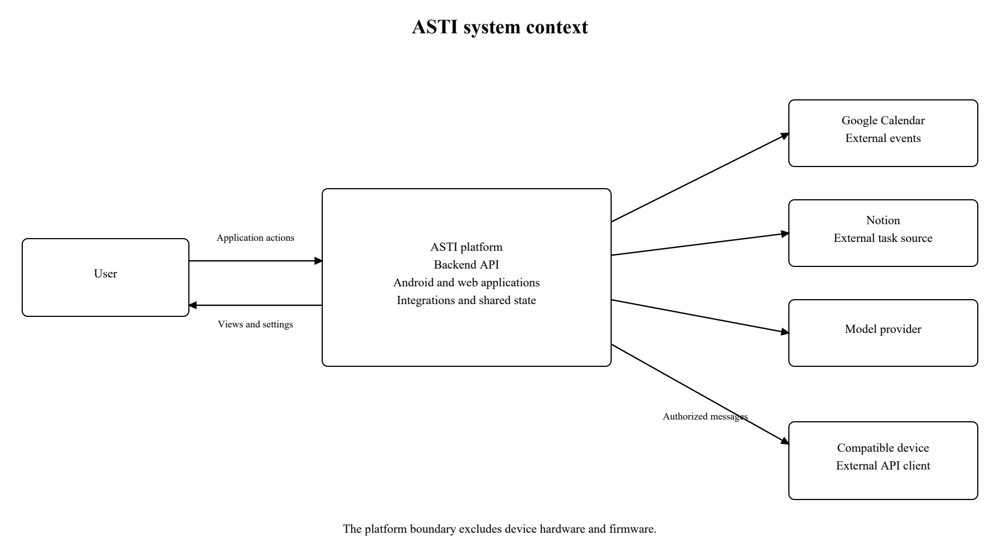
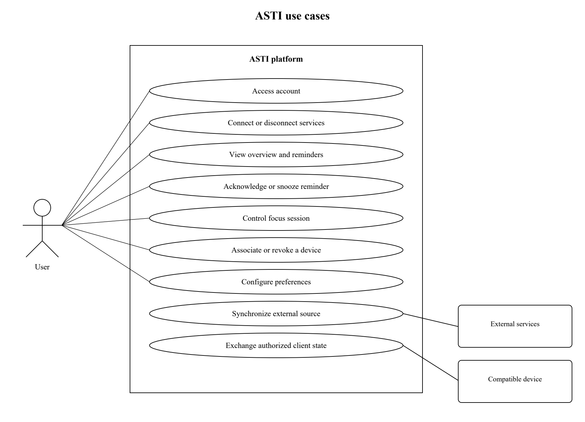
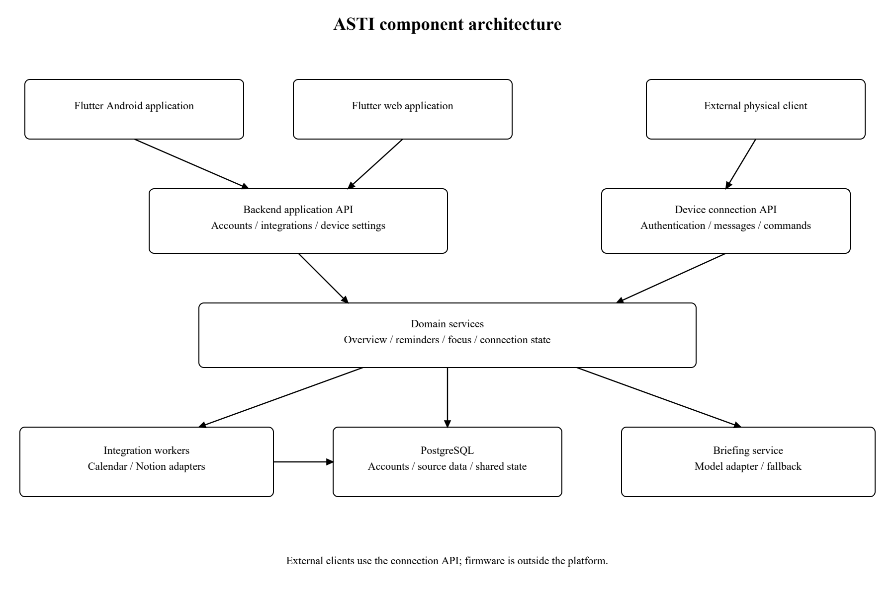
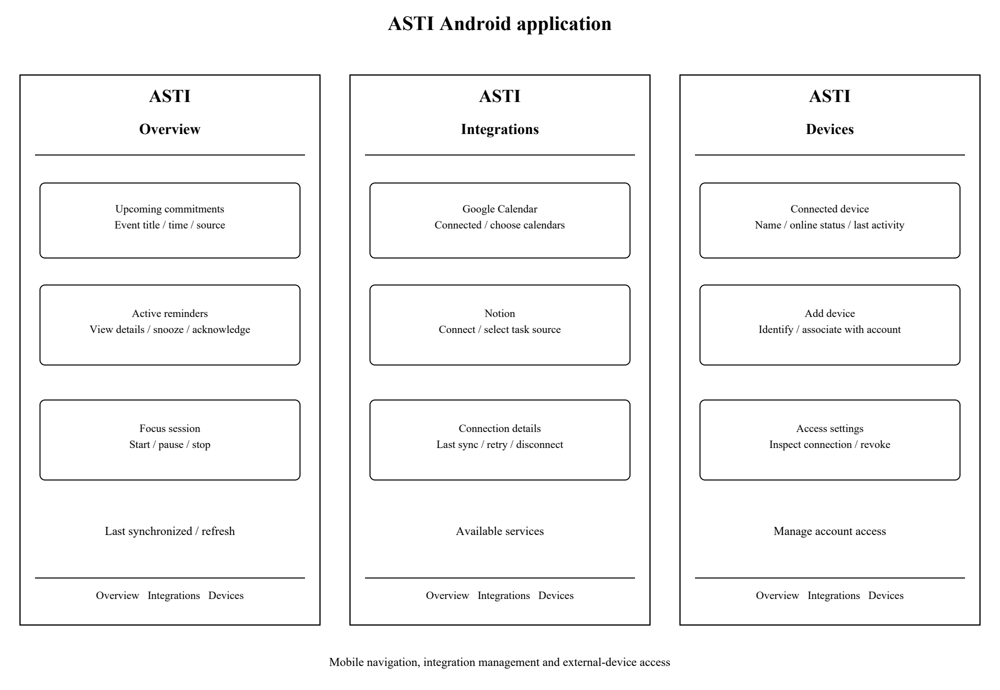
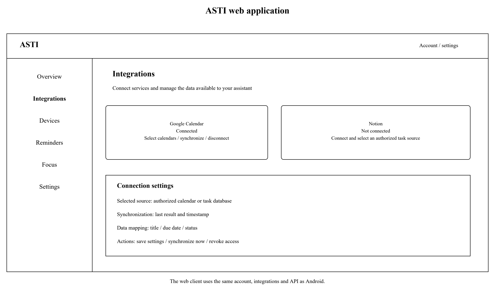

# ASTI First Probationary Period Report

Development of an Intelligent System for a Physical Desktop Assistant with a Mobile Application and External Service Integration

Author: Yan Kudashov (Кудашов Ян Сергеевич), SE-2413

Supervisor: Сарсенова Жибек Нуржановна

Astana IT University | Software Engineering | 24 October 2026

Repository: https://github.com/Kreichik/asti

Task management: https://asti-diploma.youtrack.cloud/

## 1 Project proposal

### 1.1 Problem and intended users

ASTI is a software platform consisting of a backend API, a mobile application and a web application. It connects external services to a user's account and provides a common interface through which a compatible physical assistant can receive information and exchange commands.

The system addresses the separation between personal information services, application settings and connected devices. Its architecture brings account management, integration authorization, assistant functions and device connections into one platform. Google Calendar and Notion are the first external services. Upcoming events, reminders and focus sessions provide the initial application scenarios.

The intended users are students, freelancers and office employees who organize their work through digital services. The mobile and web applications provide direct access to assistant functions as well as integration and device settings.

### 1.2 Aim and objectives

The aim is to develop a software architecture, backend API, mobile application and web application for an intelligent assistant with external-service integration and support for connected physical devices.

The objectives are to analyze related systems and research; define functional and nonfunctional requirements; design the API, data model and component interfaces; implement Android and web applications; develop Calendar and Notion adapters; provide authenticated device connections; integrate a model service for briefings; and evaluate correctness, reliability and usability.

### 1.3 Scope and expected outcomes

The project delivers the backend API, Android application, web application, external-service adapters, database schema, deployment configuration and technical documentation. The applications support account access, integration management, device association, an overview of upcoming commitments, reminders and focus sessions.

Physical devices are external clients of the platform. The connection interface defines authentication, supported messages, state updates and commands. It is independent of a particular device's construction and can be implemented by different clients that follow the documented contract. Device hardware, firmware and the device's own user interface are outside the development scope.

### 1.4 Engineering contribution

The main contribution is an integrated software architecture with clear boundaries between application clients, device connections, external-service adapters and assistant functions. It must maintain account ownership, protect credentials, preserve the meaning of imported records and keep shared state consistent across connections. Language generation is provided through a replaceable model adapter, while scheduling and access control remain deterministic.

## 2 Evidence of the relevance

### 2.1 Exploratory interviews

I conducted three discussions in person with two students and one office employee about the tools they use to organize their work and study.

| Participants | Reported tools and activities | Relevance to ASTI |
| --- | --- | --- |
| Two students | Notion, Google Calendar and Notion Calendar for planning; occasional Microsoft Teams academic events and calls | Calendar and task services are relevant initial integrations |
| One office employee | Trello for work tasks and Microsoft Teams for calls | The architecture should accommodate services beyond the first two adapters |

### 2.2 Implications for the system

The participants use several services with different roles: planning tasks, maintaining calendars and attending calls. These discussions informed the choice of Calendar and Notion for the first integration stage and the use of separate adapters for later services.

The mobile and web applications provide one place to manage these connections, view their status and use the assistant's functions. The interviews establish the participants' current service use; the usefulness of the proposed application flows will be assessed during usability evaluation.

## 3 Literature review

### 3.1 Selection and analytical approach

The review covers notifications, digital self-control, language generation, gamification and information presentation. Five of the ten scientific publications are from 2022-2024. Earlier work provides foundations for usability measurement and interaction with connected interfaces. Official technical documentation supports the analysis of integration contracts and implementation technologies.

### 3.2 Structured analysis of scientific publications

| Source | Approach and relevant finding | Limitation for ASTI | Design consequence |
| --- | --- | --- | --- |
| [1] Mark et al., 2008 | Experimental study of interrupted work; participants compensated by working faster while reporting greater strain | Controlled tasks do not establish ASTI's effect in daily work | Evaluate interruption burden; avoid assuming that more reminders mean better outcomes |
| [2] Pielot et al., 2014 | One-week field study with 15 users combining notification logs and diaries; notifications had both social benefits and costs | Small sample and an older mobile ecosystem | Provide timing controls, snooze and acknowledgment; measure usefulness by scenario |
| [3] Lyngs et al., 2022 | Analysis of digital self-control tool reviews and adoption indicators; users sought an appropriate, adaptable level of support | Self-selected reviews cannot establish causal productivity gains | Let users configure interruption/focus policies and disable optional character features |
| [4] Monge Roffarello and De Russis, 2023 | Systematic review and meta-analysis of digital self-control tools; identifies design and evaluation gaps | Technology-use reduction is not equivalent to fulfilling work obligations | Measure task comprehension and system behavior, not screen-time reduction alone |
| [5] Ji et al., 2023 | Survey of hallucination in natural language generation, including generation inconsistent with supplied sources | Broad survey, not an evaluated ASTI briefing model | Retain source IDs, validate critical dates, measure unsupported statements and provide fallback |
| [6] Liu et al., 2024 | Controlled long-context retrieval/QA experiments; performance depends on the position of relevant information | Studied models and tasks differ from short personal briefings | Select a bounded relevant record set; do not send an entire account history as context |
| [7] Li et al., 2024 | Meta-analysis and review of educational gamification; motivational effects are context dependent | Educational interventions do not establish benefit from a desktop character | Keep gamification optional and assess usability separately |
| [8] Brooke, 1996 | Introduces a low-cost system-level perceived-usability questionnaire | Subjective usability does not prove reliability or objective productivity | Combine the usability questionnaire with task completion and API reliability measurements |
| [25] Ishii and Ullmer, 1997 | Describes tangible interaction and ambient presentation through physical interfaces | Foundational interface concepts; applicability depends on the application context | Separate external client interactions from application domain services |
| [26] Pousman and Stasko, 2006 | Taxonomy of ambient systems using information capacity, notification level, representational fidelity and aesthetic emphasis | Design taxonomy; requires separate software contracts and evaluation | Offer concise overviews and configurable notifications across application clients |

### 3.3 Critical synthesis

The notification and self-control studies [1-4] support configurable reminders, acknowledgment and a focus policy. ASTI therefore gives users control over timing and presentation through its mobile and web applications. Evaluation will measure whether users can identify and manage their commitments through these interfaces.

The language-generation studies [5,6] support using a limited record set with source identifiers. Dates, reminder schedules and access decisions remain part of ordinary application logic. Generated briefings summarize imported information; a deterministic overview remains available when generation fails.

Gamification [7] is an optional extension to the application experience. Usability measurement [8] complements completion and reliability metrics. Tangible and ambient interface research [25,26] informs the separation between application state and its presentation by external clients.

## 4 Existing system comparison

### 4.1 Comparable systems

Home Assistant with Assist [22], OpenVoiceOS [23] and Stack-chan [24] provide three approaches to connecting assistant software with physical clients. Home Assistant is the closest platform analogue because it combines device connections, integrations, a web interface and a companion application. OpenVoiceOS provides a modular assistant architecture. Stack-chan provides a reference for an external embedded client.

The systems are compared against eight criteria using their official documentation [22-24]. Unverified entries identify capabilities that require further technical confirmation.

| Criterion | Home Assistant / Assist [22] | OpenVoiceOS [23] | Stack-chan [24] |
| --- | --- | --- | --- |
| Main software scope | Device/service platform with an assistant | Modular voice-assistant runtime | Firmware and applications for a desktop companion |
| Deployment boundary | Server plus dedicated or custom satellites | Linux runtime with a hardware abstraction layer | Embedded M5Stack firmware |
| Client interaction | Voice-assistant hardware; other device controls depend on configuration | Voice pipeline; PHAL exposes hardware controls | Screen face and embodied device interaction |
| Mobile / web companion evidence | Companion app and browser dashboard | GUI service documented; ASTI-like mobile onboarding unverified | Browser setup and preference tools; Android companion unverified |
| External-service extension | Integration catalogue | Skills and plugins | User applications (MODs); connector behavior application-specific |
| Client abstraction | Integrations and satellite interfaces | PHAL separates hardware-specific functions | Firmware targets and replaceable renderer/driver interfaces |
| Assistant processing | Local voice foundation; optional model integration | Intent/skill pipeline with replaceable speech components | Application-specific behavior through firmware and MODs |
| Application to ASTI | Reference for account settings, integrations and connected clients | Reference for modular assistant services and extension boundaries | Reference for the external device side of an application interface |

### 4.2 Implications for ASTI

Home Assistant provides a useful reference for a unified service and device platform. Its broad automation scope differs from ASTI's focus on personal commitments, reminders and focus sessions. OpenVoiceOS illustrates separation between assistant services and extensions, although its primary interaction model is voice. Stack-chan illustrates an embedded client that can participate in a larger system; developing such firmware is outside ASTI's scope.

ASTI concentrates on a backend API and dedicated Android and web applications. Integration adapters handle authorization and source-specific data. A separate connection interface allows compatible physical clients to consume assistant state and submit supported actions.

### 4.3 External data sources

Google Calendar and Notion are the initial sources because they are used by the student participants and provide documented access mechanisms [9-11]. Notion Calendar combines calendar accounts and dated Notion entries [12]. Trello supports dated task cards [13,14] and is a candidate for a later adapter. These services define the source data and existing workflows available to the platform.

## 5 Technology comparison

### 5.1 Backend framework

| Alternative | Fit with requirements | Main tradeoff | Initial decision |
| --- | --- | --- | --- |
| FastAPI [15] | Python API, schema validation and documented contracts for several clients | Authentication, job execution and operational policies still require deliberate implementation | Preferred for an API-centered modular backend |
| Django [16] | Python framework with built-in authentication, administration and ORM | More framework structure; a separate API layer and background execution choices remain necessary | Viable if administration-heavy workflows become central |

FastAPI is selected for its API contracts, validation facilities and compatibility with the author's Python experience. The initial deployment consists of a modular application and separately runnable workers.

### 5.2 Data storage

| Alternative | Fit with requirements | Main tradeoff | Initial decision |
| --- | --- | --- | --- |
| PostgreSQL [17] | Shared relational state for users, connector ownership, source items, reminders and device sessions | Requires service operation, backups and migrations | Preferred central database |
| SQLite [18] | Low-administration embedded/local storage and small deployments | A central multi-client workload needs deliberate concurrency and deployment assessment | Suitable for local tooling or limited cache use, not the initial shared-store choice |

Relational uniqueness constraints are important for idempotent imports and reminder occurrences. The storage model should key source items by user/connection, provider and external identity. Date-only deadlines remain distinct from exact timestamps. No vector store is justified for the initial bounded overview.

### 5.3 Component communication

| Alternative | Fit with requirements | Main tradeoff | Initial decision |
| --- | --- | --- | --- |
| HTTPS polling | Simple request/response and recoverable snapshots | Update delay and repeated requests depend on polling interval | Simple baseline for client connections |
| Secure WebSocket [19] | Persistent bidirectional updates for state and application commands | Requires reconnect, heartbeat, authorization and replay rules | Preferred live channel for compatible clients |
| MQTT over TLS [20] | Publish/subscribe designed for constrained clients | Adds a broker, topic authorization and delivery-state semantics | Alternative if device constraints justify broker operation |

The connection interface carries state revisions, action identifiers, timestamps and acknowledgments. The backend deduplicates repeated action identifiers. Reconnecting clients receive the current state and the applicable reminder status.

### 5.4 Client framework and model deployment

Flutter supports Android and web targets [21] and matches the author's experience. Shared presentation/domain code is desirable, while pairing and platform-specific storage need separate implementations and verification. Native Android plus a separate web stack is an alternative with more independently maintained client code; a web-only implementation would not satisfy the planned Android deliverable.

The briefing service uses a pretrained-model API through a replaceable adapter. A self-hosted model is an alternative, while a deterministic ordered overview provides the operational fallback. Provider selection depends on output quality, latency, data handling and cost.

### 5.5 Application architecture

A modular backend keeps accounts, integrations, assistant functions and device connections within one deployable application. Background workers perform source synchronization and scheduled processing. This structure supports the initial project scale while keeping interfaces between modules explicit.

An extension built on Home Assistant [22] could reuse platform functions, but would couple the project to its configuration and entity model. A standalone API gives the Android and web applications a domain model designed around the selected assistant scenarios. OpenVoiceOS [23] is most relevant if voice interaction becomes a central requirement.

## 6 Requirements specification

### 6.1 Functional requirements

Must identifies the required first-version functions. Should identifies optional extensions.

| ID | Priority | Requirement and acceptance criterion |
| --- | --- | --- |
| FR-01 | Must | Authenticate users and isolate their data: one user cannot read another user's items, connection secrets or device controls |
| FR-02 | Must | Import Google Calendar events preserving external identity, start/end, time zone and source reference; report revoked authorization |
| FR-03 | Must | Import selected Notion task data using documented property mapping; absent due dates remain absent |
| FR-04 | Must | Preserve provider, external ID, connection ownership, source URL where available and last successful synchronization |
| FR-05 | Must | Present an overview automatically on first interaction after a configurable inactivity interval, without restarting it on every menu action |
| FR-06 | Must | Schedule contextual reminders; snooze affects the reminder, not the external deadline; acknowledgment is synchronized |
| FR-07 | Must | Start, pause, resume and stop focus/break intervals; recover timer state from authoritative timestamps after reconnection |
| FR-08 | Must | Support overview, integration/settings management and focus controls in Android and web without requiring a physical device |
| FR-09 | Must | Associate a compatible external device with an account through the applications; revocation blocks subsequent protected access |
| FR-10 | Must | Expose authorized API commands for reminder acknowledgment, snooze and focus control; return the resulting state to connected clients |
| FR-11 | Must | Generate source-grounded briefing text with a bounded timeout and deterministic fallback; failed generation does not stop reminder delivery |
| FR-12 | Should | Allow optional notification sound and character preferences to be configured through the applications |
| FR-13 | Must | Display synchronization freshness and actionable connection errors; stale records are not described as live |
| FR-14 | Should | Permit manual synchronization without duplicate source items |
| FR-15 | Must | Publish a versioned external-client contract and validate supported message types; unsupported versions return a compatibility error |
| FR-16 | Must | Validate device actions by owner, action ID and state revision; retries have one accepted effect and reconnect restores current state |

### 6.2 Nonfunctional requirements

| ID | Priority | Requirement and proposed acceptance condition |
| --- | --- | --- |
| NFR-01 | Must | No connector tokens in Git, logs or client responses; encrypt stored tokens with separately managed key material |
| NFR-02 | Must | Repeated imports and repeated action IDs do not create duplicate records or effects |
| NFR-03 | Must | Explicit time semantics cover UTC/local conversion, all-day events, date-only tasks, recurrence exceptions and midnight boundaries |
| NFR-04 | Must | Network recovery restores current state and follows a documented policy for missed/expired reminders |
| NFR-05 | Should | Proposed p95 ordinary backend response below 500 ms under a documented test workload, excluding external/provider waits |
| NFR-06 | Should | Proposed healthy-connection server reminder dispatch within 5 seconds of its schedule; import freshness is measured separately |
| NFR-07 | Must | Model calls have a configured timeout, fallback and non-sensitive latency/usage diagnostics |
| NFR-08 | Must | Connector additions do not require changing focus-timer or client domain logic |
| NFR-09 | Must | Trace imports, reminders and actions using correlation identifiers; verify key failure paths |

Performance targets apply to a documented workload on the deployment server. The initial integrations read source information; acknowledging an ASTI reminder does not change the corresponding Notion task.

## 7 Architecture and Diagrams

### 7.1 System boundary and components

The system comprises the backend API, Android application, web application, database and background workers. External services and compatible physical devices connect through documented interfaces.

The API provides account access, integration authorization, device association, overview records, reminder commands and focus-session operations. The Android and web applications use these endpoints to provide their screens and settings. A connection adapter exposes a limited set of authenticated operations to external physical clients.

Integration workers import authorized Calendar and Notion data through separate adapters. Domain services maintain reminders, focus sessions and briefings. External-service credentials remain on the server and are not included in client responses.

Diagrams are available as editable SVG files and PNG/PDF exports: https://github.com/Kreichik/asti/tree/main/docs/diagrams

### 7.2 Data and consistency

The main entities are User, ServiceConnection, SourceItem, ReminderOccurrence, DeviceConnection, ClientAction, FocusSession and Briefing. ServiceConnection records the authorized source and its synchronization status. SourceItem retains external identity, date semantics and provenance. DeviceConnection records the associated account, connection status and API version.

A client action has an identifier and an expected state revision. The backend checks ownership, applies an accepted command once and returns its outcome. Reconnecting clients obtain the latest state before continuing. Focus sessions use server timestamps so that Android, web and external clients share the same remaining duration.

### 7.3 Intelligent processing

The briefing service selects relevant source records and passes a bounded request to the model adapter. Event times and deadlines are rendered from stored records. The response is checked against supplied source identifiers before presentation. A timeout or invalid result returns the deterministic overview of the same records.

## 8 UX and prototype

### 8.1 Application navigation

The Android application and web application provide five main areas: Overview, Integrations, Devices, Focus and Settings. Navigation and data remain consistent across the two clients, while layouts suit the available screen size.

### 8.2 Overview and assistant functions

The overview presents upcoming events, dated tasks, active reminders and the current focus session. Each record includes its source and synchronization status. Users can open details, acknowledge or snooze a reminder, and start or control a focus interval directly in the application.

The overview refreshes when the application becomes active after the configured inactivity interval. The same information is available through the API to authorized external clients.

### 8.3 Integration catalogue

The integration screen lists available services and their connection status. Connecting Google Calendar starts the authorization flow and allows calendar selection. Connecting Notion allows selection of the authorized task source and its property mapping. The user can inspect the last synchronization, retry a failed synchronization or disconnect a service.

### 8.4 Device connections

The Devices area lists connected devices with their name, connection state and last activity. The Add Device action starts account association through the supported connection method. Users can inspect a connection and revoke access from either application. Device construction and firmware are handled outside the platform.

### 8.5 Preferences and error states

Settings include reminder timing, focus duration, notification preferences and account controls. Connection errors identify the affected service or device and provide a retry or reconnect action. Empty views distinguish an account without integrations from a connected source with no upcoming records.

Editable wireframes and their PNG/PDF exports are available at https://github.com/Kreichik/asti/tree/main/docs/prototype

## 9 Verification and evaluation plan

### 9.1 Baselines and evaluation questions

The evaluation covers API correctness, integration reliability, shared state and usability of the Android and web applications. Manual checking of the same calendar and task sources provides the workflow baseline. A deterministic ordered overview provides the baseline for model-generated briefings. HTTPS snapshot requests provide a transport baseline for live connection updates.

### 9.2 Verification matrix

| Area | Evidence | Acceptance basis |
| --- | --- | --- |
| Accounts and access | Two accounts, unauthorized requests and revoked connections | No cross-account access or credential disclosure |
| External integrations | Source records compared with imports; updates, pagination and expired access | Correct identities and dates; no duplicate items |
| API and shared state | Commands issued from Android, web and an external client | One effect per action ID and consistent returned state |
| Device connection interface | Authorized connection, unsupported version, interruption and reconnect | Explicit errors, revoked access denied and current state restored |
| Reminders and focus | Scheduled and actual dispatch times; acknowledgment, snooze and timer actions | Correct timing policy and shared session state |
| Briefings | Declared model configuration, source records and outputs | Source coverage, date correctness, unsupported-statement rate and fallback behavior |
| Application usability | Participants connect a service, inspect the overview and manage a device connection | Task completion, time, errors and perceived usability [8] |

### 9.3 Measurement conditions

Measurements record server resources, software versions, network conditions, Android/browser versions, source record counts and concurrent connections. Import delay, scheduling delay, API response time and client update time are measured separately. Timing results include the sample count, median, p95 and failures.

The application walkthrough uses the same task scenarios and comparable source records for each participant. It covers integration setup, overview navigation, reminder control and device access management. A compatible physical client is used to check the external interface without adding firmware development to the project.

### 9.4 Evaluation outputs

The evaluation produces API and integration results, response-time measurements, shared-state checks and a usability summary. Each result records the tested version, environment and acceptance criterion.

## 10 Project management and risks

### 10.1 Responsibility and workflow

Yan Kudashov is responsible for analysis, architecture, backend development, Android and web applications, integration adapters, verification and documentation. The supervisor reviews key deliverables at agreed checkpoints.

Repository: https://github.com/Kreichik/asti. YouTrack board: https://asti-diploma.youtrack.cloud/agiles/204-1/current. Tasks record ownership, priorities, dates and acceptance criteria. Task IDs link changes to commits and pull requests. The first submission is identified by the tag prob-period-1.

ASTI-1 covers the initial repository and scope. ASTI-2 and ASTI-3 cover analysis and design. ASTI-4 tracks supervisor feedback and ASTI-5 covers submission preparation. ASTI-6 through ASTI-11 cover external integrations, domain services, applications, the device API interface, briefings and evaluation.

### 10.2 Proposed milestones

| Milestone | Deliverable and exit condition | Timing |
| --- | --- | --- |
| M1 Analysis submission | Eleven-section report, diagrams, prototype materials, linked tasks and accessible version | 24 October 2026, before 18:00 |
| M2 Integration foundation | Account isolation, schema, Calendar/Notion authorization and idempotent imports | Planned next stage; dates to agree with supervisor |
| M3 Core assistant | Session overview, reminder scheduler, focus state and Android/web flows | After M2 |
| M4 Device connection API | Account association, supported commands, updates, reconnect and revocation | After API and shared-state contracts |
| M5 Evaluation and defense | Measured reliability/usability, deployment guide and application and external-client demonstration | Aligned with the university's later defense schedule |

### 10.3 Risks and dependencies

| Risk | Consequence | Mitigation and verification |
| --- | --- | --- |
| Source access or institutional restrictions | A connector cannot obtain the required data | Validate Google/Notion early; keep Moodle and other connectors optional |
| Scope expansion across clients and services | Core flows remain unfinished | Fix two initial connectors and three core scenarios; keep voice/camera and extra services outside the baseline |
| Model hallucination or provider outage | Incorrect briefing or unavailable generation | Use source references, critical-field validation and deterministic fallback; measure actual outputs |
| Date/recurrence errors | Missing or misleading reminders | Preserve source semantics; test all-day/date-only records, time zones and exceptions |
| Device/network instability | Inconsistent controls or stale display | Versioned API, action identifiers, reconnect snapshots and explicit connection status |
| Credential disclosure or overbroad permissions | Unauthorized access to personal sources | Minimal scopes, encrypted server storage, redacted logs and account-isolation checks |
| Limited interview evidence | Proposed benefits are overstated | Evaluate the application flows with participants |
| Missing substantive supervisor review | Required feedback evidence is incomplete | Reserve a review checkpoint and track resulting revisions |

## 11 Supervisor feedback

### 11.1 Topic approval

The supervisor agreed to the proposed diploma topic.

### 11.2 Deliverable review

The report has been sent to the supervisor. Feedback on the deliverables is pending.

## References

[1] G. Mark, D. Gudith and U. Klocke. The Cost of Interrupted Work: More Speed and Stress. CHI, 2008. Author manuscript: https://www.ics.uci.edu/~gmark/chi08-mark.pdf

[2] M. Pielot, K. Church and R. de Oliveira. An in-situ study of mobile phone notifications. MobileHCI, 2014, pp. 233-242. https://doi.org/10.1145/2628363.2628364

[3] U. Lyngs et al. The Goldilocks level of support: Using user reviews, ratings, and installation numbers to investigate digital self-control tools. International Journal of Human-Computer Studies, 166, 102869, 2022. https://doi.org/10.1016/j.ijhcs.2022.102869

[4] A. Monge Roffarello and L. De Russis. Achieving Digital Wellbeing Through Digital Self-Control Tools: A Systematic Review and Meta-Analysis. ACM Transactions on Computer-Human Interaction, 30(4), 2023. https://doi.org/10.1145/3571810

[5] Z. Ji et al. Survey of Hallucination in Natural Language Generation. ACM Computing Surveys, 55(12), article 248, 2023. https://doi.org/10.1145/3571730

[6] N. F. Liu et al. Lost in the Middle: How Language Models Use Long Contexts. Transactions of the Association for Computational Linguistics, 12, pp. 157-173, 2024. https://aclanthology.org/2024.tacl-1.9/

[7] L. Li, K. F. Hew and J. Du. Gamification enhances student intrinsic motivation, perceptions of autonomy and relatedness, but minimal impact on competency: a meta-analysis and systematic review. Educational Technology Research and Development, 72, pp. 765-796, 2024. https://doi.org/10.1007/s11423-023-10337-7

[8] J. Brooke. SUS: A quick and dirty usability scale. In Usability Evaluation in Industry, 1996. Author chapter: https://hci-studies.org/methods-and-measures/downloads/SUS_Brooke1996.pdf

[9] Google. Calendar API events resource and list method. https://developers.google.com/workspace/calendar/api/v3/reference/events and https://developers.google.com/calendar/api/v3/reference/events/list

[10] Notion. Add and manage connections with the API. https://www.notion.com/help/add-and-manage-connections-with-the-api

[11] Notion. Calendar view databases. https://www.notion.com/help/calendars

[12] Notion. Use Notion Calendar with Notion. https://www.notion.com/en-gb/help/use-notion-calendar-with-notion

[13] Atlassian. Add a due date or start date to a card. https://support.atlassian.com/trello/docs/adding-dates-to-cards/

[14] Atlassian. How to Toggle Trello Views: Calendar, Table, Timeline and More. https://trello.com/en/guide/activate-views

[15] FastAPI. Features. https://fastapi.tiangolo.com/features/

[16] Django Software Foundation. Django overview. https://www.djangoproject.com/start/overview/

[17] PostgreSQL Global Development Group. About PostgreSQL. https://www.postgresql.org/about/

[18] SQLite. Appropriate Uses For SQLite. https://www.sqlite.org/whentouse.html

[19] MDN Web Docs. WebSocket API. https://developer.mozilla.org/en-US/docs/Web/API/WebSockets_API

[20] MQTT. Frequently asked questions. https://mqtt.org/faq/

[21] Flutter. Build for and integrate with multiple platforms. https://docs.flutter.dev/platform-integration

[22] Home Assistant. Assist, integrations and companion documentation. https://www.home-assistant.io/voice_control/ ; https://www.home-assistant.io/integrations/ ; https://companion.home-assistant.io/

[23] OpenVoiceOS. Project architecture and hardware integration documentation. https://github.com/OpenVoiceOS/OpenVoiceOS/blob/main/README.md ; https://openvoiceos.github.io/beta-technical-manual/hardware-integrators/

[24] Stack-chan project. Official repository and firmware API. https://github.com/stack-chan/stack-chan ; https://stack-chan.github.io/stack-chan/firmware/docs/api.html

[25] H. Ishii and B. Ullmer. Tangible Bits: Towards Seamless Interfaces between People, Bits and Atoms. CHI, 1997. https://www.media.mit.edu/publications/tangible-bits-towards-seamless-interfaces-between-people-bits-and-atoms-2/

[26] Z. Pousman and J. Stasko. A taxonomy of ambient information systems: four patterns of design. AVI, 2006, pp. 67-74. https://doi.org/10.1145/1133265.1133277

Technical documentation accessed on 24 October 2026.
